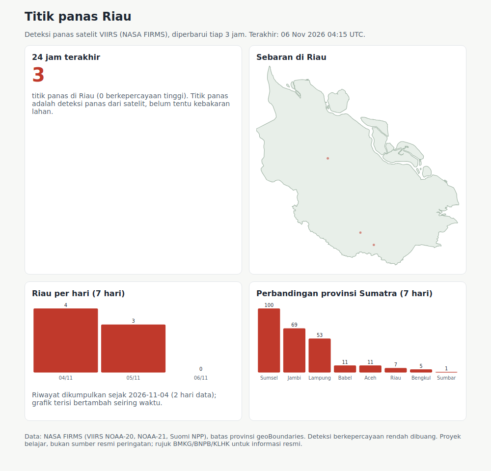

# Hotspot watch: Riau and Sumatra

A small, self-updating dashboard of satellite **hotspots** (heat detections, not confirmed fires) for Riau, with a comparison across Sumatra provinces.



## What it does
1. Downloads the last 24 hours of VIIRS active-fire detections for Southeast Asia from NASA FIRMS (NOAA-20, NOAA-21 and Suomi NPP), no API key needed.
2. Drops low-confidence detections and assigns every point to a province with a point-in-polygon test (province borders from geoBoundaries).
3. Stores the points in SQLite, de-duplicated, so a history builds up over time.
4. Writes one self-contained HTML page: count for the last 24 hours, map of Riau, 7-day trend for Riau, and 7-day totals by province.

It is meant to run from cron every few hours:

```bash
pip install -r requirements.txt
python watch.py /var/www/hotspots/index.html     # 15 */3 * * *
pytest -q
```

## Honest notes
- A hotspot is a satellite heat detection. It can be a fire, a flare or hot ground. For official information use BMKG, BNPB or KLHK.
- The history only goes back to the day you first run it; the FIRMS 24-hour feed has no archive. The 7-day chart fills in over a week.
- The "today" bar covers a partial UTC day.
- Province borders come from a simplified file, so points very close to a border can land in the neighbouring province.

## Data and licences
- Fire data: NASA FIRMS (LANCE), VIIRS 375 m active fire, used with acknowledgement.
- Borders: [geoBoundaries](https://www.geoboundaries.org/) (CC BY 4.0), downloaded on first run.
- Code: MIT.
